  

<h2 align="center"><a href="https://github.com/anaidyss/hypr-shell">hypr-shell</a></h2>

  a whole desktop for hyprland, written in quickshell. one frame around the screen, every menu grows out of it, 
  and the whole system (shell, terminal, GTK, Qt, browser, even the cursor) repaints itself from the wallpaper.

  

<table>
  <tr>
    <td valign="top" width="33%">
      <b>dashboard</b> 
      calendar, weather, media with synced lyrics, a 10-band pipewire eq you drag as one curve, live spectrum
    </td>
    <td valign="top" width="33%">
      <b>drives</b> 
      ISO library that knows when a newer release is out, write and verify, ventoy, backups, catches fake-capacity sticks
    </td>
    <td valign="top" width="33%">
      <b>everything else</b> 
      lock screen on PAM, screenshot editor, launcher + calculator + clipboard + notes, control center, night light
    </td>
  </tr>
</table>

## tools

<table>
  <tr>
    <th align="left" width="50%">project</th>
    <th align="center" width="50%">demo</th>
  </tr>
  <tr>
    <td valign="top">
      <b><a href="https://github.com/anaidyss/cursor-tint">cursor-tint</a></b> 
      python · pillow · xcursor  
      the bibata cursor in any color, rebuilt in a second. hook it to
      matugen and the cursor follows the wallpaper accent like everything
      else. writes the xcursor files itself, no node toolchain.
    </td>
    <td align="center" valign="top">
      
    </td>
  </tr>
  <tr>
    <td valign="top">
      <b><a href="https://github.com/anaidyss/veil">veil</a></b> 
      python · pywayland · pillow · pam  
      a lockscreen for niri on ext-session-lock-v1. frames drawn with
      pillow, password checked via PAM, and the compositor holds the lock
      session, so kill won't save you. fake audit log at the bottom because
      it looks cool.
    </td>
    <td align="center" valign="top">
      
    </td>
  </tr>
  <tr>
    <td valign="top">
      <b><a href="https://github.com/anaidyss/zh-notes">zh-notes</a></b> 
      python · sqlite fts5 · cedict · anki  
      a cli for chinese lesson notes. type pinyin or paste hanzi, it looks
      the word up offline in CC-CEDICT plus a russian dictionary and
      appends a ruby-annotated card to your obsidian note. anki decks are
      built from the same file, no second database to keep in sync.
    </td>
    <td align="center" valign="top">
      
    </td>
  </tr>
  <tr>
    <td valign="top">
      <b><a href="https://github.com/anaidyss/kb_macro">kb_macro</a></b> 
      python · evdev · uinput  
      a global keyboard macro recorder in one file. evdev grabs every
      keyboard on the system, uinput replays the recording at 2x. works
      everywhere: terminal, browser, games.
      <code>Ctrl+Alt+R</code> to record, <code>Ctrl+Alt+P</code> to play.
    </td>
    <td align="center" valign="top">
      
    </td>
  </tr>
  <tr>
    <td valign="top" colspan="2">
      <b><a href="https://github.com/anaidyss/honor-touchpad-gestures">honor-touchpad-gestures</a></b>
      · python · hid 
      linux touchpad gestures for the honor magicbook art 14: volume and brightness on the edges through the
      firmware's own HID reports, two-finger double click.
    </td>
  </tr>
</table>

## setup

arch linux + hyprland + [hypr-shell](https://github.com/anaidyss/hypr-shell) on an honor magicbook with an OLED.
before that: fedora + niri, one forest palette everywhere ([dotfiles](https://github.com/anaidyss/dotfiles), archived).

email is in git log if you need me.
